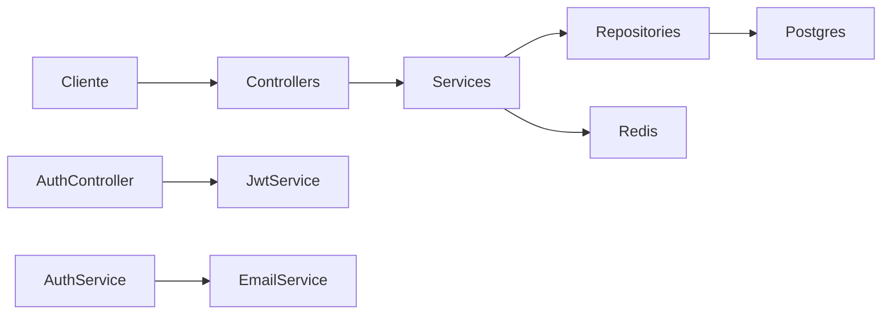

# e-commerce-api

API REST de un e-commerce personal. Cubre autenticación de cuentas, catálogo (categorías y productos), usuarios, perfiles y direcciones. No incluye carrito, pedidos ni pagos.

La documentación interactiva se genera con springdoc OpenAPI: con la aplicación en marcha, Swagger UI está en [http://localhost:8080/swagger-ui.html](http://localhost:8080/swagger-ui.html) y la especificación en [http://localhost:8080/v3/api-docs](http://localhost:8080/v3/api-docs).

## Stack

- Java 17
- Spring Boot 4.1.0: Web, Data JPA, Security, Validation, Mail, Data Redis
- JWT con jjwt 0.12.5
- springdoc OpenAPI
- PostgreSQL 16 y Redis 7.2, definidos en [docker-compose.yml](docker-compose.yml)
- Lombok

## Arquitectura

El código sigue capas de Spring:

| Paquete | Responsabilidad |
|---|---|
| `controllers` | Endpoints HTTP y códigos de respuesta |
| `services` | Reglas de negocio, caché y envío de correo |
| `repositories` | Acceso JPA |
| `domain` | Entidades y el enum `Rol` |
| `dto` | Records de entrada y salida |
| `mapper` | Conversión entre entidad y DTO |
| `security` | Filtro JWT, `UserDetails` y cadena de seguridad |
| `exceptions` | Errores de dominio y el manejador global |



## Modelo de dominio

- `Usuario`: email único, contraseña, rol (`CLIENTE` o `ADMIN`) y `isEnable` (cuenta activada). Por defecto la cuenta nace desactivada.
- `Perfil`: nombre, apellido y teléfono. Relación 1:1 con `Usuario`. `Perfil` es el dueño de la clave foránea.
- `Direccion`: título, calle, ciudad, provincia, código postal y país. Varias direcciones por usuario.
- `Categoria`: nombre único y descripción. Una categoría tiene muchos `Producto`.
- `Producto`: nombre, descripción, precio, stock, URL de imagen y categoría obligatoria.

El registro público crea el usuario y el perfil en la misma transacción (`CascadeType.ALL`).

## Requisitos y arranque

Hace falta JDK 17, Docker y el wrapper de Maven del repositorio.

1. Levantar PostgreSQL y Redis:

```bash
docker compose up -d
```

Postgres escucha en `localhost:5432` (base `ecommerce_db`, usuario `ecommerce_user`). Redis escucha en `localhost:6379`.

2. Arrancar la API:

```bash
# Windows
mvnw.cmd spring-boot:run

# Linux o macOS
./mvnw spring-boot:run
```

El servidor usa el puerto **8080**.

### Configuración

Los valores viven en [src/main/resources/application.properties](src/main/resources/application.properties). Las claves relevantes son:

| Clave | Uso |
|---|---|
| `spring.datasource.*` | Conexión a PostgreSQL y pool HikariCP |
| `spring.jpa.hibernate.ddl-auto` | Hoy vale `create-drop`: Hibernate recrea el esquema al arrancar y lo borra al parar |
| `spring.sql.init.mode` | Hoy vale `always`: [data.sql](src/main/resources/data.sql) se ejecuta en cada arranque, después de crear las tablas |
| `application.security.jwt.secret-key` | Clave HMAC del JWT |
| `application.security.jwt.expiration` | Vida del access token, en milisegundos (24 h en la configuración actual) |
| `application.security.verification-url` | Base del enlace que se pone en el correo de activación |
| `spring.mail.*` | SMTP. La configuración actual apunta a Mailtrap |
| `spring.data.redis.host` / `port` | Redis para la caché de catálogo |

El archivo de properties contiene secretos locales (clave JWT, SMTP y contraseña de base de datos). Este README no los reproduce. Conviene sustituirlos por variables de entorno antes de publicar el repositorio.

Hay un bloque comentado para H2 en memoria y la consola en `/h2-console`. El perfil activo es PostgreSQL.

## Seguridad

La sesión es stateless y CSRF está desactivado. [SecurityConfig](src/main/java/com/api/security/config/SecurityConfig.java) deja públicos estos caminos:

- `/api/v1/auth/**`
- `/v3/api-docs/**`, `/swagger-ui/**`, `/swagger-ui.html`
- `/error`

Cualquier otra ruta exige una cabecera:

```http
Authorization: Bearer <access-token>
```

El filtro JWT lee esa cabecera, valida el token y carga el usuario por email. La cuenta tiene que estar activada (`isEnable = true`); si no, Spring Security la trata como deshabilitada.

Los roles se persisten y viajan en el claim `roles` del access token (`ROLE_CLIENTE` o `ROLE_ADMIN`). La cadena de seguridad no distingue roles: un cliente autenticado puede llamar los mismos endpoints que un administrador.

Las contraseñas del registro público se guardan con BCrypt.

## Autenticación

### 1. Registro

`POST /api/v1/auth/register`

Crea un usuario con rol `CLIENTE`, `isEnable = false` y su perfil. Si el email ya existe, el servicio lanza `IllegalArgumentException` (ese caso no está mapeado al `409` del manejador global).

Cuerpo:

```json
{
  "email": "ana@example.com",
  "password": "secreto12",
  "nombre": "Ana",
  "apellido": "Gómez",
  "telefono": "600111222"
}
```

Respuesta `200`:

```json
{
  "mensaje": "Registro exitoso. ...",
  "activationToken": "<jwt de verificación>"
}
```

El token de activación caduca a las 24 horas (`application.security.jwt.verification-expiration`, valor por defecto del servicio). El correo se envía por el SMTP configurado. El enlace del mensaje se construye con `application.security.verification-url`, que hoy apunta a `/api/v1/auth/confirm`. Ese path no existe. Para activar la cuenta hay que usar el endpoint siguiente con el `activationToken` de la respuesta (o el query param `token` del correo, si se corrige la URL).

### 2. Activación

`GET /api/v1/auth/activateAccount?token=<activationToken>`

Respuesta `200` en texto plano: cuenta activada, o aviso de que ya lo estaba. Un token inválido o caducado produce `IllegalArgumentException`.

### 3. Login

`POST /api/v1/auth/login`

```json
{
  "email": "ana@example.com",
  "password": "secreto12"
}
```

Respuesta `200`:

```json
{
  "authorizationToken": "<jwt>",
  "type": "Bearer",
  "email": "ana@example.com",
  "rol": "CLIENTE"
}
```

Credenciales incorrectas o cuenta sin activar responden **401** con un texto plano (`BadCredentialsException` o `DisabledException`), generado en el propio controlador, no con el JSON de `ErrorResponse`.

### Ejemplo encadenado

```bash
# Registro
curl -s -X POST http://localhost:8080/api/v1/auth/register \
  -H "Content-Type: application/json" \
  -d "{\"email\":\"ana@example.com\",\"password\":\"secreto12\",\"nombre\":\"Ana\",\"apellido\":\"Gomez\",\"telefono\":\"600111222\"}"

# Activación: sustituir TOKEN por activationToken
curl -s "http://localhost:8080/api/v1/auth/activateAccount?token=TOKEN"

# Login
curl -s -X POST http://localhost:8080/api/v1/auth/login \
  -H "Content-Type: application/json" \
  -d "{\"email\":\"ana@example.com\",\"password\":\"secreto12\"}"

# Catálogo, con el access token
curl -s http://localhost:8080/api/productos \
  -H "Authorization: Bearer ACCESS_TOKEN"
```

En Swagger UI, el esquema `bearerAuth` pide el access token para probar el resto de rutas.

## Endpoints

Todas las rutas salvo `/api/v1/auth/**` requieren JWT.

### Auth — `/api/v1/auth`

| Método | Ruta | Auth | Éxito | Cuerpo |
|---|---|---|---|---|
| `POST` | `/register` | Público | 200 `RegisterResponseDTO` | `email`, `password`, `nombre`, `apellido`, `telefono` |
| `GET` | `/activateAccount?token=` | Público | 200 texto | — |
| `POST` | `/login` | Público | 200 `AuthResponseDTO` | `email`, `password` |

### Productos — `/api/productos`

| Método | Ruta | Éxito | Notas |
|---|---|---|---|
| `POST` | `/` | 201 `ProductoResponseDTO` | Crea el producto en la categoría indicada |
| `GET` | `/` | 200 lista | |
| `GET` | `/{id}` | 200 `ProductoResponseDTO` | |
| `DELETE` | `/{id}` | 200 texto | |

Cuerpo de alta:

```json
{
  "nombre": "Auriculares",
  "descripcion": "Inalámbricos",
  "precio": 59.90,
  "stock": 20,
  "imagenUrl": "https://example.com/auriculares.jpg",
  "categoriaId": 1
}
```

La respuesta incluye `id`, `nombre`, `descripcion`, `precio`, `stock`, `imagenUrl` y `nombreCategoria`.

### Categorías — `/api/categorias`

Solo lectura. No hay alta ni borrado por API.

| Método | Ruta | Éxito |
|---|---|---|
| `GET` | `/` | 200 lista de `CategoriaResponseDTO` (`id`, `nombre`, `descripcion`) |
| `GET` | `/{id}` | 200 `CategoriaResponseDTO` |

### Usuarios — `/api/usuarios`

| Método | Ruta | Éxito | Notas |
|---|---|---|---|
| `POST` | `/` | 201 `UsuarioResponseDTO` | Crea un `CLIENTE` |
| `GET` | `/` | 200 lista | |
| `GET` | `/{id}` | 200 `UsuarioResponseDTO` | |
| `DELETE` | `/{id}` | 200 texto | |

Cuerpo: `email` y `password`. La respuesta devuelve `id`, `email` y `rol` (nunca la contraseña).

Este alta es distinta del registro público: el mapper guarda la contraseña tal como llega, sin BCrypt, y la cuenta queda con `isEnable` en falso. Para obtener un usuario que pueda iniciar sesión, usa `/api/v1/auth/register` y la activación.

### Perfiles — `/api/perfiles`

| Método | Ruta | Éxito | Notas |
|---|---|---|---|
| `POST` | `/` | 201 `PerfilResponseDTO` | Un perfil por usuario |
| `GET` | `/` | 200 lista | |
| `GET` | `/{idUsuario}` | 200 `PerfilResponseDTO` | Busca por id de usuario, no por id de perfil |
| `PUT` | `/{idUsuario}` | 200 `PerfilResponseDTO` | Actualiza nombre, apellido o teléfono |

Cuerpo de alta y actualización:

```json
{
  "nombre": "Ana",
  "apellido": "Gómez",
  "telefono": "600111222",
  "idUsuario": 2
}
```

La respuesta repite `nombre`, `apellido`, `telefono` e `idUsuario`.

### Direcciones — `/api/direcciones`

| Método | Ruta | Éxito |
|---|---|---|
| `POST` | `/{idUsuario}` | 201 `DireccionResponseDTO` |

```json
{
  "titulo": "Casa",
  "calle": "Calle Mayor 12",
  "ciudad": "Madrid",
  "provincia": "Madrid",
  "codigoPostal": "28001",
  "pais": "España"
}
```

La respuesta añade `idUsuario`. No hay listado, detalle ni borrado de direcciones.

## Validaciones

Bean Validation se aplica en los cuerpos marcados con `@Valid`: registro, login, alta de producto, alta de usuario y alta de perfil.

| Campo | Regla |
|---|---|
| Email | Obligatorio y con formato de email |
| Contraseña (registro y alta de usuario) | Obligatoria, mínimo 8 caracteres |
| Nombre, apellido, teléfono (registro) | Obligatorios. Teléfono de registro: máximo 20 caracteres |
| Teléfono de perfil | Obligatorio, máximo 9 caracteres |
| Precio | Obligatorio, mínimo `0.01` |
| Stock | Obligatorio, mínimo 0 |
| Descripción de producto | Máximo 500 caracteres |
| `categoriaId` | Obligatorio |
| Código postal | 5 caracteres |

`POST /api/direcciones/{idUsuario}` no anota el cuerpo con `@Valid`, así que esas restricciones no se ejecutan en esa ruta. En `PUT /api/perfiles/{idUsuario}` la anotación `@Valid` está sobre el path variable, no sobre el cuerpo.

Un cuerpo inválido en un endpoint con `@Valid` responde **400** con `ErrorResponse`. El campo `message` agrupa los errores de campo, por ejemplo `{password=La contraseña debe tener al menos 8 caracteres, email=Formato de email inválido}`.

## Errores

[GlobalExceptionHandler](src/main/java/com/api/exceptions/GlobalExceptionHandler.java) devuelve este JSON:

```json
{
  "timestamp": "2026-11-21T18:00:00",
  "status": 404,
  "error": "Recurso no encontrado",
  "message": "Producto con id 99 no encontrado",
  "path": "/api/productos/99"
}
```

| Situación | HTTP | `error` |
|---|---|---|
| Validación de cuerpo (`@Valid`) | 400 | Error de Validación en los datos enviados |
| Producto, categoría, usuario o perfil no encontrado | 404 | Recurso no encontrado |
| Email duplicado en `POST /api/usuarios` | 409 | Conflicto - Email ya existente |
| El usuario ya tiene perfil | 409 | Conflicto - Perfil ya asignado |
| Login inválido o cuenta desactivada | 401 | Texto plano, fuera de este formato |

Una petición sin token, o con un token inválido, a una ruta protegida la rechaza Spring Security (401).

## Caché

Redis está activo (`@EnableCaching` en [RedisConfig](src/main/java/com/api/config/RedisConfig.java)).

| Operación | Caché |
|---|---|
| Listar productos | `listaProductos`, clave `todos` |
| Producto por id | `productos`, clave = id |
| Alta de producto | Escribe `productos` para ese id e invalida `listaProductos` |
| Borrado de producto | Invalida esa entrada de `productos` y `listaProductos` |
| Listar categorías | `listaCategorias`, clave `todas` |
| Categoría por id | Caché de nombre `productos`, clave = id de la categoría |

La primera lectura de la lista de productos y del producto por id espera 500 ms antes de ir a base de datos. Las lecturas siguientes salen de Redis mientras la entrada siga vigente. Crear o borrar un producto no vacía la caché de categorías.

## Datos de ejemplo

[data.sql](src/main/resources/data.sql) inserta, en cada arranque:

- Categorías Tecnología y Accesorios.
- Tres productos: Portátil PRO 14, Ratón Ergonómico Inalámbrico y Teclado Mecánico RGB.
- Usuarios de ejemplo `admin@ecommerce.com` (ADMIN) y `cliente@ecommerce.com` (CLIENTE), con perfiles y dos direcciones del cliente.

Esas contraseñas están en texto plano. El login compara contra un hash BCrypt, así que esas cuentas del script no sirven para autenticarse. La vía usable es el registro, la activación y el login.

Como el esquema es `create-drop` y el script corre siempre, cualquier dato creado por la API desaparece al reiniciar el proceso.

## Estructura del proyecto

```text
e-commerce-api/
├── docker-compose.yml
├── pom.xml
├── mvnw / mvnw.cmd
└── src/main/
    ├── java/com/api/
    │   ├── ECommerceApiApplication.java
    │   ├── config/          OpenAPI y Redis
    │   ├── controllers/     REST, auth en controllers/web
    │   ├── domain/          entidades y Rol
    │   ├── dto/             request y response
    │   ├── exceptions/
    │   ├── mapper/
    │   ├── repositories/
    │   ├── security/        filtro JWT, UserDetails y config
    │   └── services/
    └── resources/
        ├── application.properties
        └── data.sql
```
